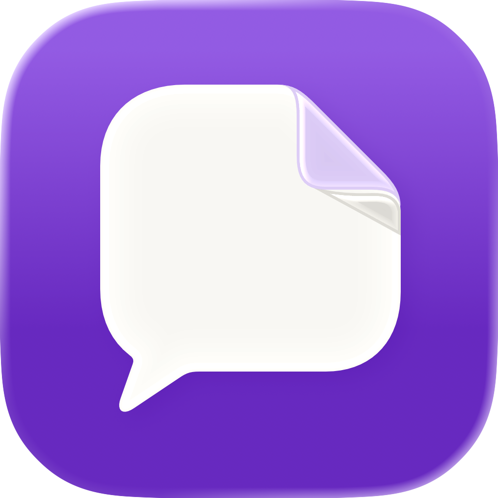

# DeskMate

A native macOS assistant for questions, selected files and services you choose — with answers written on your Mac.

## Highlights

- **Ask and follow up.** Stream an answer, stop it, refine the question and continue the conversation.
- **Bring your files.** Select folders or attach TXT, Markdown and text-based PDFs. Inspect the passages behind file citations.
- **Keep useful work.** Resume local conversations after restart; edit and save briefs or action lists as Markdown.
- **Open it where you work.** Use a desktop widget, a configurable shortcut or the menu bar. Pin the compact panel or expand into the main window.
- **Connect deliberately.** Configure a Streamable HTTP MCP service, enable its tools and approve the exact arguments before every call.

## Get started

This prototype is built and signed locally. A GitHub source archive is not a notarized, ready-to-install app.

1. Build the app using the [local setup and signing instructions](docs/local-prototype.md#build-test-and-run).
2. Open `dist/DeskMate.app`, then move the signed app to `~/Applications/DeskMate.app` for regular use.
3. Ask a question in English. Add folders through **My files**, or use the attachment button for a single question.
4. For a service, open **Connections**, add its address, test it and enable only the tools you want. Nothing is sent by adding a connection; each model-requested call needs approval.

For widgets, right-click the desktop, choose **Edit Widgets**, then find **DeskMate**. The small widget opens the assistant; the medium widget also offers New chat, Ask my files and Resume. A real Apple Development signature and matching App Group are required for gallery use. No paid Developer Program enrollment was used for the verified local installation.

The default shortcut is **Option+Space**. Change it in **Settings** if another app handles that combination; **Control+Shift+K** is the verified configuration on the target Mac. The menu bar remains another way to open the assistant.

## Requirements

- macOS 26 or later on an Apple Intelligence-compatible Mac.
- Apple Intelligence enabled and an available on-device Foundation Models model; English must be supported. The verified Mac uses English as its primary language.
- Swift 6.2 or later. Full Xcode compiles the layered app icon; Command Line Tools use the static icon fallback. Gallery widgets require a real Apple Development identity and matching App Group. The verified toolchain is Xcode 27 with a macOS 26 deployment target; the app requires no macOS 27 features.

## Your data and the model

DeskMate uses **Apple’s on-device model through Foundation Models**. Apple does not expose its exact version to apps. There is no cloud inference fallback, GPT connection or Private Cloud Compute model in this prototype.

Conversations and selected-file indexes stay in DeskMate’s local container. The app reads only selected material. MCP is a separate boundary: approved arguments go to the configured service, and the answer shows a separate remote-transfer label. Credentials stay in Keychain. Widget snapshots contain generic state, never prompts, document titles or answer text.

## Known limitations

- The local model can misread sources, omit facts or make incorrect claims. Citations show the excerpts it received; they do not guarantee every sentence is supported. A follow-up may help.
- Retrieval is keyword-based. Image-only PDFs, OCR, DOCX and web pages are not supported. The library supports up to 200 files. Text/Markdown files are limited to 1 MB; PDFs to 10 MB and 50 pages. A question can attach up to five files.
- The model has a 4096-token context window on the verified Mac. Older turns may remain visible outside its restored memory, and attachments are not reattached by retry after restart.
- MCP compatibility is limited to the supported Streamable HTTP and input-schema subset. This is not a claim of compatibility with every server.
- This is a locally signed prototype, not a notarized installer or an App Store release. See the [verification runbook](docs/local-prototype.md) for tested behavior and the limits of that evidence.

## Source and verification

- [Build, signing, MCP fixture and verification runbook](docs/local-prototype.md)
- [Product specification](docs/specyfikacja-produktowa.md) · [Design system](docs/design-system.md)
- [Approved icon source and artwork QA](assets/app-icon/README.md)
- [Issues](https://github.com/t13foundation/apple-deskmate/issues) · [Project](https://github.com/orgs/t13foundation/projects/10)
